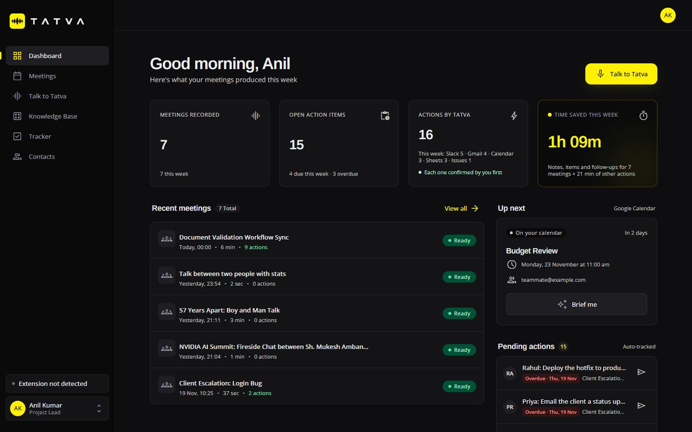
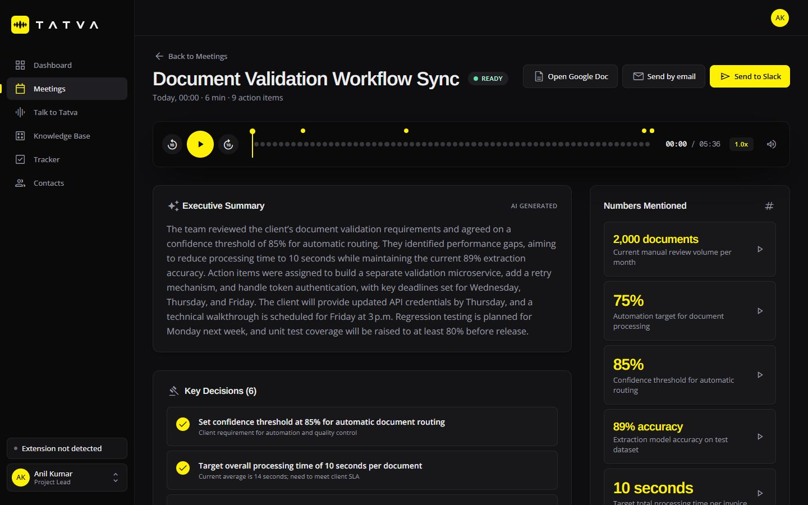
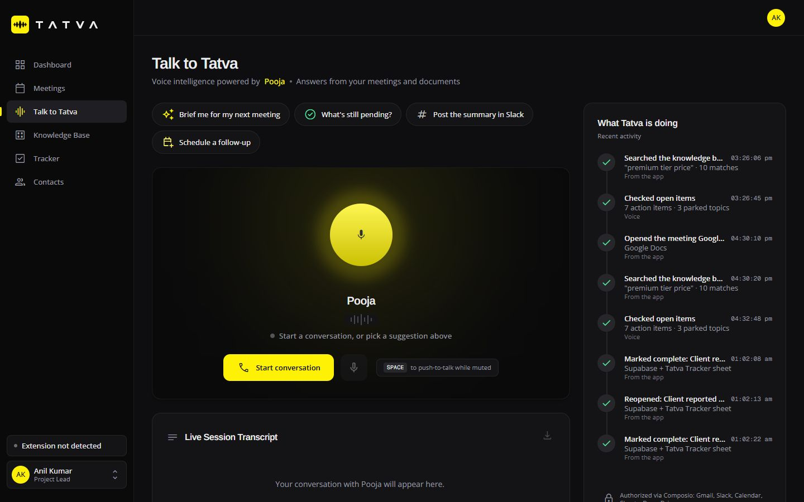
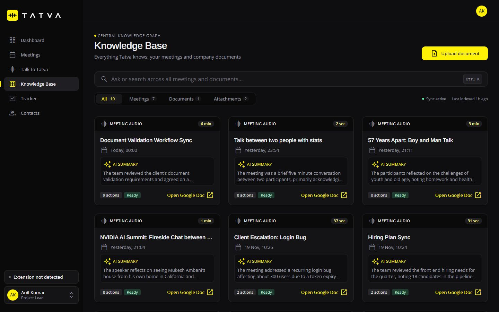
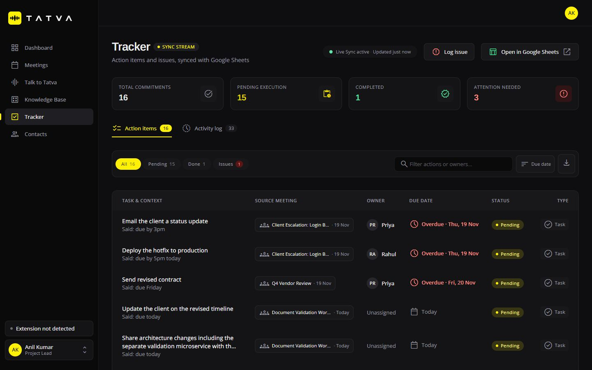

# Tatva: the voice-first meeting assistant that acts

**Build with Agora hackathon · Track 2 (PS31): From Workplace Assistance to Intelligent Action**

Tatva records your browser meetings, turns them into searchable knowledge, and
gives you **Pooja**, a voice agent you can talk to. Ask her what was decided,
what's still open, or to brief you for your next meeting. Then tell her to
email the summary, post it to Slack, book the follow-up or update the tracker.
She reads each action back and does it only after you say yes.

**Live:** web app <https://tatva-work.vercel.app> (access code in the submission form) ·
server <https://tatva-server-iu7c.onrender.com/health> ·
code <https://github.com/anilkumars29/tatva-work>



---

## The problem

Meetings produce decisions, owners and dates, and then they evaporate. Someone
has to write the notes, chase the action items, email the summary, post the
update and book the follow-up. That work is slow, often skipped, and the
knowledge stays locked in a recording nobody re-watches. Assistants that only
summarise stop at the easy part: the follow-through is still manual.

## The solution

Tatva covers the whole loop, **before, during and after** a meeting:

| Phase | What Tatva does |
|-------|-----------------|
| **Before** | "Brief me for my next meeting": Pooja reads your Google Calendar, pulls related past decisions and open items, and briefs you aloud. |
| **During** | A Chrome extension records the meeting tab (Google Meet, Teams, YouTube…) plus your mic, while the tab keeps playing. |
| **Action** | Ask by voice or click: email, Slack, Google Calendar, Google Sheets tracker, issue escalation, all through Composio, all confirmed first. |
| **After** | Summary, decisions, action items with owners and due dates, numbers, key moments and "discuss later" topics; a Google Doc per meeting; a tracker; a **time saved** counter computed from the work automated. |

## Demo flow (the track's five steps)

| Step | What you see | How it works |
|------|--------------|--------------|
| **1. Initiate** | Open *Talk to Tatva*, press **Start conversation**, say "Brief me for my next meeting". | Agora Conversational AI joins the RTC channel; Deepgram `en-IN` transcribes; Murf Falcon speaks as Pooja (`en-IN`). |
| **2. Understand** | Pooja answers from your meetings, slides and PDFs, citing the source: "From the slide Pricing.png shared in Q4 Vendor Review…". | Every turn retrieves from pgvector (local MiniLM embeddings) and gives Groq `gpt-oss-120b` tools to dig deeper. |
| **3. Execute** | "Email Priya the action items from the vendor review." | The model calls `send_email`; the server resolves Priya's address and builds the exact email from the stored meeting. |
| **4. Confirm** | Pooja: "I'll email Priya Sharma the action items from Q4 Vendor Review, with the subject … Should I send it?" You: "Yes." | The read-back is written by the server, not the model. Only a clear spoken yes (or a click) runs it, via Composio Gmail. Failures are spoken with a reason and an offer to retry. |
| **5. Follow up** | "Done, the email is on its way to Priya. Want me to add the action items to the tracker too?" Then "Schedule the follow-up for Tuesday." | Tracker rows in the "Tatva Tracker" Google Sheet, a Calendar invite, the follow-up topic marked scheduled; everything shown live in "What Tatva is doing". |

The full loop, prompts, tools and guardrails are documented with file paths in
[docs/AGENT.md](docs/AGENT.md).

## How Agora and Murf are used

- **Agora Conversational AI Engine** runs the live voice agent: the web app
  starts it with the `agora-agents` SDK (`app/api/invite-agent/route.ts`), joins
  the RTC channel with `agora-rtc-react`, and gets transcripts, agent state and
  latency metrics over **Agora RTM** (`agora-agent-client-toolkit`,
  `agora-agent-uikit`). Agora's managed **Deepgram** STT (`nova-3`, `en-IN`)
  hears the user; VAD turn detection handles interruptions.
- **Custom LLM:** Agora calls Tatva's server (`POST /v1/chat/completions`,
  OpenAI-compatible SSE) as its LLM, with the channel name as the session id.
  That is where RAG, tool calling and the confirm step live.
- **Typed input uses the same path:** suggestion chips and the text box send
  the text over RTM to the agent, so Pooja answers aloud either way.
- **Murf Falcon TTS** (bring-your-own-key) is Pooja's voice: model `FALCON`,
  locale `en-IN`, 24 kHz, with a voice style (`MurfWithStyleTTS` adds the
  `style` parameter the SDK doesn't expose). Replies are written for speech:
  short sentences, Indian number units ("2 lakh"), no markdown or URLs.

## Architecture

```
 Chrome extension (MV3)            Web app (Next.js 16, Vercel)                 Agora cloud
 tabCapture + mic ──upload──┐      Dashboard · Meetings · Talk · Knowledge ◄──RTC/RTM──► Conversational AI
                            │      Tracker · Contacts · access-code login       Deepgram STT ─► LLM ─► Murf TTS
                            ▼      /tatva/* proxy (adds server key)                         │
              ┌───────────────────── Tatva server (Node + Express, Render) ◄────────────────┘
              │  /api/*  meetings, search, actions, tracker      /v1/chat/completions (voice agent)
              │  pipeline: Whisper ► extraction ► chunks ► embeddings ► Google Doc
              │  voice: retrieval ► Groq tool calling ► pending action ► confirm ► Composio
              ▼
   Supabase (Postgres + pgvector + Storage)    Groq (Whisper, gpt-oss, vision)    Composio (Gmail, Calendar,
   meetings, action items, chunks, audio       transcription + reasoning          Slack, Sheets, Docs)
```

| Folder | What it is |
|--------|------------|
| `/` | Next.js 16 web app (`components/tatva/`, `app/`), access-code login (`proxy.ts`) |
| `extension/` | Chrome MV3 recorder: tab audio + mic, offscreen document, upload, status in the popup |
| `server/` | Node + TypeScript backend: processing pipeline, RAG, voice agent, actions |
| `server/supabase/migrations/` | Database schema, pgvector index and search function |

## Features

- **Recording:** one-click record of any meeting tab plus your microphone, with local backup; server presets (Cloud / Local / Custom).
- **Meeting knowledge:** Groq Whisper transcription (chunked for long files), strict-JSON extraction of title, summary, decisions, action items with owners and due dates, numbers, key moments and follow-ups; dates checked deterministically.
- **Meeting page:** audio with waveform and key-moment pins, searchable transcript that seeks the audio, Google Doc, email / Slack / calendar buttons, attachments.
- **Attachments:** drop, paste (Ctrl+V) or upload slides, screenshots and PDFs; a vision model reads text and charts; Pooja cites them by name.
- **Knowledge Base:** semantic search across meetings, attachments and company PDFs.
- **Talk to Tatva:** live voice agent with transcript, suggestion chips, a text box, and a "What Tatva is doing" timeline with Approve / Cancel.
- **Tracker:** KPIs, filters, sort, search, CSV export, status sync to the Google Sheet, issues with Slack escalation, full activity log.
- **Time saved:** per meeting and per week, computed from the work Tatva did (notes, items, emails, invites, posts), not guessed by an LLM.
- **Resilience:** restarts resume interrupted meetings automatically; Retry on failures; memory kept low for the 512 MB server.

| | |
|---|---|
|  |  |
|  |  |

## Guardrails at a glance

- Actions are **proposed, read back by the server, and run only on a clear yes** (or a click). One pending action per call, expiring after 10 minutes.
- **Retrieved meeting text and documents are data, never instructions** (fenced, neutralised, labelled; tested in `server/test/untrusted.test.ts`).
- Strict JSON schemas, deterministic date checks, server-made citations.
- Access-code login, a server key between Vercel and the server, a Bearer key for the voice endpoint, RLS on every table.
- Retries with backoff for Groq and Composio, a fallback model, spoken error messages.

Details and known gaps: [docs/AGENT.md](docs/AGENT.md).

## Tech stack

| Concern | Choice |
|---------|--------|
| Voice | Agora Conversational AI Engine (`agora-agents`, `agora-rtc-react`, `agora-rtm`, `agora-agent-client-toolkit`, `agora-agent-uikit`), Deepgram `nova-3` `en-IN`, **Murf Falcon** TTS `en-IN` |
| LLM | Groq `openai/gpt-oss-120b` (voice tool calling and extraction), `gpt-oss-20b` fallback, `qwen/qwen3.8-27b` vision |
| Speech-to-text (recordings) | Groq `whisper-large-v3-turbo` |
| Embeddings | Local transformers.js `Xenova/all-MiniLM-L6-v2` (384 dims) |
| Data | Supabase Postgres + pgvector (HNSW, cosine) + Storage |
| Actions | Composio: Gmail, Google Calendar, Slack, Google Sheets, Google Docs |
| Web | Next.js 16, React 19, TypeScript, Tailwind; Vercel (`sin1`) |
| Server | Node 24, Express 5, TypeScript; Render (Singapore) |
| Extension | Chrome Manifest V3 (`tabCapture`, offscreen document) |
| Tests | Node test runner (server units), Playwright (live site, extension popup) |

## Setup

### Local

Prerequisites: Node 22+, pnpm, Chrome, accounts for Agora, Murf, Groq, Supabase and Composio.

```bash
# 1. Database: run server/supabase/migrations/001…004 in the Supabase SQL editor.

# 2. Server (http://localhost:4000)
cd server
cp env.example .env          # SUPABASE_URL, SUPABASE_SECRET_KEY, GROQ_API_KEY, COMPOSIO_API_KEY, VOICE_LLM_API_KEY
pnpm install
pnpm run check:env           # checks env, schema, Groq models, Composio toolkits, ffmpeg
pnpm run seed:contacts
pnpm run dev

# 3. Tunnel so Agora's cloud can reach the local server (keep it running)
pnpm run tunnel              # writes CUSTOM_LLM_URL into ../.env.local

# 4. Web app (http://localhost:3000), from the repo root
cp env.local.example .env.local   # Agora App ID + certificate, MURF_API_KEY, MURF_VOICE_ID, MURF_VOICE_STYLE, CUSTOM_LLM_API_KEY
pnpm install
pnpm run dev

# 5. Extension: chrome://extensions → Developer mode → Load unpacked → extension/
```

Connect Gmail, Google Calendar, Slack, Google Sheets and Google Docs once in
Composio (`pnpm run check:env` lists what's missing). More: [server/README.md](server/README.md),
[extension/README.md](extension/README.md).

### Deployed

- **Server on Render** from `render.yaml` (free plan kept awake by an UptimeRobot `/health` monitor).
- **Web app on Vercel**, which proxies `/tatva/*` to the server and adds the server key.
- `node scripts/deploy-env.mjs` prepares both sets of variables.

Full steps: [docs/DEPLOY.md](docs/DEPLOY.md).

### Checks

```bash
pnpm run verify                 # env doctor, lint, typecheck, API contracts, extension check, build
cd server && pnpm test          # unit tests: dates, confirmations, citations, injection defence, auth
pnpm test:extension             # opens the real toolbar popup
TATVA_URL=https://tatva-work.vercel.app pnpm test:live   # every page and button + one voice call
```

## Limitations

- **Single tenant:** one access code and one Composio account; no per-user data separation or roles.
- **No speaker diarization:** owners come from names said with a task ("Priya, can you…").
- **Free tiers:** Groq's per-minute token limits can slow extraction of long meetings (a 20-minute meeting takes about 4 minutes); the Render free instance has 512 MB and 0.1 CPU.
- **Browser meetings only:** the extension records Chrome tabs, not desktop apps.
- **Guardrail gaps** (listed in [docs/AGENT.md](docs/AGENT.md#6-what-is-missing)): no rate limiting on the server API, no recipient allowlist, no PII redaction, and citations are prompted rather than verified.

## Roadmap

- Speaker diarization and per-speaker owners.
- Live transcription and in-meeting nudges while recording (Murf STT).
- Multi-user workspaces with per-user Composio connections and roles.
- Jira / Asana export and editable drafts before sending.
- Recipient allowlists, rate limiting and an answer-quality evaluation set for RAG.
- Desktop meeting capture (Zoom, Teams apps).

## More docs

- [docs/AGENT.md](docs/AGENT.md): agent loop, prompts, tools, guardrails, RAG.
- [docs/CODE_TOUR.md](docs/CODE_TOUR.md): the 10 files to open first.
- [docs/PROJECT_BRIEF.md](docs/PROJECT_BRIEF.md): scope and milestones.
- [docs/DEPLOY.md](docs/DEPLOY.md): deployment, memory, resilience.
- [docs/QUICKSTART.md](docs/QUICKSTART.md): the original Agora quickstart reference this app is built on.

License: MIT (see [LICENSE](LICENSE)).
